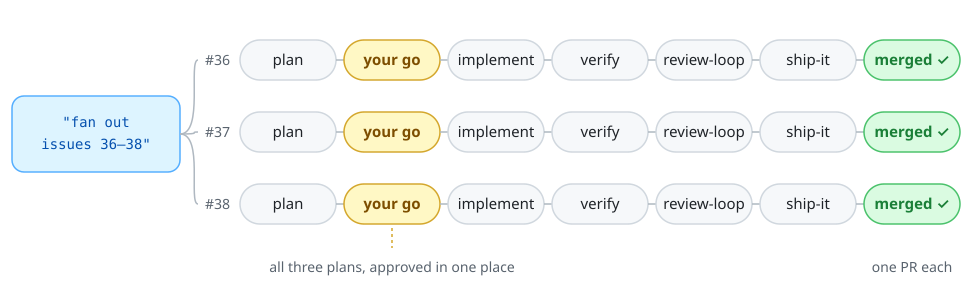

# Good Vibes Only ✌️

Claude Code plugins that take care of the annoying parts of agent work, from babysitting a PR to sitting out a usage limit, so your agents stay on track and you don't have to watch them.

[](#install)
[](https://github.com/pingdotgg/t3code)
[](https://github.com/dinooo13/good-vibes-only/actions/workflows/ci.yml)
[](LICENSE)

## Install

In Claude Code, add the marketplace, then install the plugins you want:

```
/plugin marketplace add dinooo13/good-vibes-only
/plugin install usage-limits@good-vibes-only
/plugin install good-vibes-only@good-vibes-only
```

That's it. Claude picks the skills up from what you say, or you call one directly, like `/good-vibes-only:ship-it`.

- **`usage-limits`** keeps long runs alive: Claude stops cleanly before a usage limit and the same thread carries on after the reset. Works with or without T3 Code.
- **`good-vibes-only`** bundles eleven workflow skills, made for [T3 Code](https://github.com/pingdotgg/t3code). They use its threads, delegated agents, PR watching, preview browser, device tools and scheduled tasks.

## What you get

- **"Ship it" means shipped.** Not "PR opened, good luck". CI, review bots, rebases, the merge, the deploy and a look at it live are part of the job.
- **A second pair of eyes on every change.** A fresh reviewer with no history checks it, round after round, until it approves.
- **Parallel work without the chaos.** Hand over a few issues. Each gets its own thread and worktree, and you approve all the plans in one place.
- **Proof, not vibes.** Changes are shown working in the preview browser, the simulator or the real app, hard states included, instead of resting on green mocked tests.
- **Long runs that outlast your quota.** Near a limit, Claude wraps up, waits for the reset, and picks up where it left off.

## The lineup

| Skill | Say | What you get |
| --- | --- | --- |
| **Land changes** | | |
| [ship-it](#ship-it) | "ship it", "merge when green" | Proof, PR, babysitting, rebase, merge, pull main, install or deploy, a live check, cleanup |
| [review-loop](#review-loop) | "review loop", "council" | Fresh Opus xhigh reviewers, round after round, until one approves |
| [verify](#verify) | "verify yourself" | Proof you can see: preview browser, simulator, the real app, the hard states |
| [pr-comments](#pr-comments) | "draft a reply on the PR" | Short comments in your voice, drafts before people see them, a note on bot replies |
| **Run agents for longer** | | |
| [fan-out](#fan-out) | "fan out issues 36, 37 and 38" | One T3 thread per issue: plan, your go, implement, verify, review, ship |
| [handoff](#handoff) | "write a handoff" | A brief that lets a new thread carry on without your history |
| [hill-climb](#hill-climb) | "keep iterating until the reviewer gives at least 9" | Critic rounds with a fixed rubric until the score reaches the target |
| [usage-limits](#usage-limits) | "watch my usage" | A clean stop before the limit, and the same thread back at work after the reset |
| **Keep tabs** | | |
| [project-digest](#project-digest) | "anything I need to look at?" | Who's waiting on you, what's broken, what's ready to merge |
| [tidy-repos](#tidy-repos) | "clean up branches" | Merged branches and clean worktrees go; stale work gets listed |
| **Polish the product** | | |
| [product-readme](#product-readme) | "make the README sell it" | A README that sells: hero, real screenshots, short install |
| [web-quality](#web-quality) | "check the Core Web Vitals" | Lighthouse, SEO and GEO, and a visual pass, before and after |

## How they team up

The skills lean on each other, which is why they ship as one plugin. ship-it proves changes with verify and answers bots with pr-comments. fan-out writes its briefs with handoff and sends every PR through review-loop and ship-it:

<p align="center">
  <picture>
    <source media="(prefers-color-scheme: dark)" srcset="assets/fan-out-dark.svg">
    
  </picture>
</p>

## The skills

### ship-it

"Ship it" should mean shipped. The skill proves the change before the PR, then babysits checks and review bots: it fixes the real findings, answers false positives with a reason, and declines scope creep. It rebases when the branch falls behind and only merges once the gate is green. After the merge it pulls main, installs or deploys, and looks at the result live. Each project describes its verify, merge, after-merge and live-check steps in a `## Ship` section of its `CLAUDE.md` or `AGENTS.md`. Without one, the skill works them out from the repo and proposes the section.

"PR" or "babysit the PR" alone stops at the merge gate.

### review-loop

A second opinion, as many times as it takes: three rounds by default, up to five for security, auth, data loss or concurrency. The reviewer, Opus at xhigh unless you name another, runs in its own thread with no history and labels each finding blocker, should or nit. You fix what's real, push back with evidence, and decline scope creep. Say "council" to get three providers at once: Claude Opus, GPT Sol and a third through OpenCode. The verdicts per round end up in the PR description.

### verify

Green mocked tests aren't proof. verify picks the way to see the change working: the T3 preview browser for the web (`playwright-cli` outside T3), the device tools for simulators, the built app for macOS, curl and logs for servers. It also opens the states that hide bugs, like everything switched on, the longest text, the phone width, and light and dark. It never kills the copy of the app you're using, and it tells you what it couldn't verify.

### pr-comments

Comments that sound like you on a good day: two or three sentences, the point first, friendly to people and no filler. Anything a person will read is shown to you as a draft first. Replies to review bots go out directly, with a note that an agent wrote them.

### fan-out

Hand it a handful of issues. It writes the missing "Done when" criteria, works out which issues depend on each other, and starts one T3 thread per issue in its own worktree. Each thread runs the whole flow: a Fable planner, a short summary for you, an Opus implementer, then verify, review-loop and ship-it on its own PR. You approve all the plans in one place. Threads take turns on shared resources like benchmarks, and a dependent issue starts only after the issue it needs has merged. With `--plan-only` it just posts plans on the issues, which makes a nice overnight job.

### handoff

New thread, no memory. The brief carries the task, the reasons, what's already decided, what to read, how to verify and when it's done. It prints it, saves it, launches it as a T3 thread, or turns it into a `/goal` under 4,000 characters.

### hill-climb

Give it a target ("at least 9 out of 10") and it brings in a fresh, independent critic every round. The critic never hears the target. It scores the work with a fixed rubric against fresh captures, including the hard states, and ranks what holds the score down. Implementers fix the top defects and the next critic comes back. The climb stops at the target (after one confirmation round), when the score plateaus, or when the budget runs out. The design decisions get written down, so the next change keeps the direction. For code, use review-loop.

### usage-limits

Nothing kills the vibe like hitting your usage limit mid-run, with half the work done.

This skill keeps an eye on your 5-hour and 7-day usage windows while Claude works. When a limit gets close, Claude finishes the current step, commits, leaves itself a handoff note, and waits until the window resets. Then the same thread wakes up, reads the note, and carries on. Claude loads the skill on its own before long jobs, or when you say "watch my usage" or "continue when my limit resets".

**Waking up.** Claude starts a background script that sleeps until the window resets, then exits. Claude Code notifies the same thread, and Claude picks up where it left off. The wait itself costs no tokens.

**The hook.** Claude can't feel time passing, so the plugin adds a hook as a backstop. At most every 2 minutes, after a tool call or when you send a message, it looks at the cached usage. It stays silent until usage gets high, then tells Claude to load the skill: a heads-up at 75% of the 5-hour window, and a wrap-up at 90% of the 5-hour window or 95% of the weekly one. The hook never waits on the network; when the cache is old, it refreshes it in the background for the next check. Set `USAGE_HOOK=0` to turn it off.

**Tuning.** Claude wraps up at 90% of the 5-hour window (`USAGE_WRAP_PCT`) and 95% of the weekly windows (`USAGE_WRAP_7D_PCT`). Set either one in the `env` block of `~/.claude/settings.json`; the hook, the watcher and the checks all follow them. Leave some room: subagents keep using quota while Claude wraps up, and the hook only checks every 2 minutes.

**How it knows.** Usage comes from Anthropic's OAuth usage endpoint, using the token Claude Code already stores (macOS keychain, or `~/.claude/.credentials.json` on Linux). The token goes to curl on stdin, never on a command line, and is never cached or printed. When the endpoint rate-limits, every check on the machine backs off (1 minute, doubling up to 15). Meanwhile the skill asks [CodexBar](https://github.com/steipete/CodexBar) if it's installed (it's optional), or uses the last good result for up to 15 minutes, clearly marked as stale.

**Requirements.** `bash`, `curl`, `jq`, and a Claude Code login with a Pro or Max subscription.

**One catch.** The wait belongs to the Claude Code session. If you close the CLI or the app, nothing resumes.

### project-digest

The morning read: new issues and comments from real people (first-timers flagged), PRs that are ready, failing or behind, red CI on main, your PRs in other people's repos, and unreleased commits. If nothing needs you, it says so in one line. It's read only, so it's safe to run on a schedule.

### tidy-repos

Branches whose PRs merged, worktrees that are clean and merged, stale refs: gone. Squash and rebase merges are detected through GitHub, so nothing is guessed from `git branch --merged`. Anything unmerged or with changes is listed for you, never deleted. It also never touches a worktree that an unsettled T3 thread still owns, or one holding ignored files like `.env`.

### product-readme

READMEs that sell the product to the people who'll use it: a one-line value, a hero in light and dark, real screenshots with believable demo data, claims backed by something in the repo, and the developer details moved to where developers look. It drafts the repo description and topics too, and applies them only after your OK. This README is its own work.

### web-quality

Lighthouse on the production build, a median of three runs per page and configuration, the pages that matter, SEO and GEO done properly, and a visual pass at phone, tablet and desktop widths in light and dark. You get a before-and-after table and an honest note on where chasing the last point stopped being worth it.

## Credits

Several skills borrow ideas from Theo's [tstack](https://github.com/t3dotgg/tstack): review-loop from `council` and `sol-loop`, ship-it from `babysit-pr` and `full-send`, and pr-comments from `leaving-pr-comments`.

Before a push, run `scripts/check-plugins.sh` (manifests and skill frontmatter) and `tests/usage-limits.sh` (offline tests for the usage-limits scripts). CI runs both, plus ShellCheck and Claude Code's plugin validator.

[MIT](LICENSE) © Fabian Meyer
