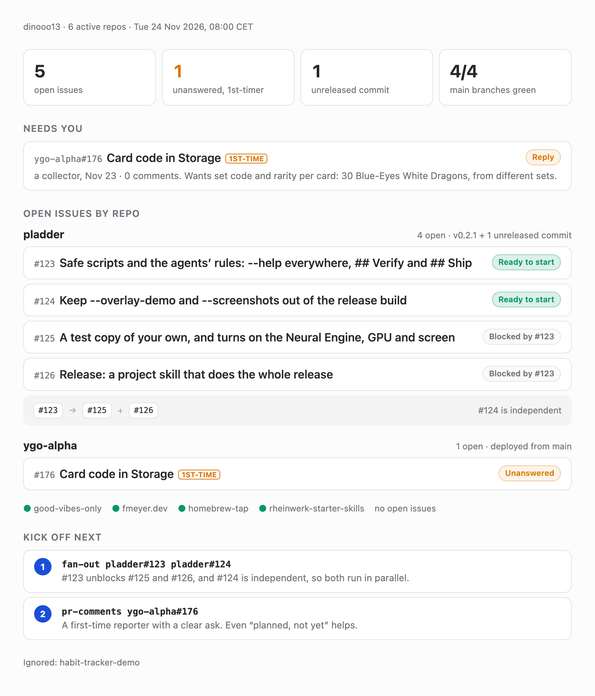
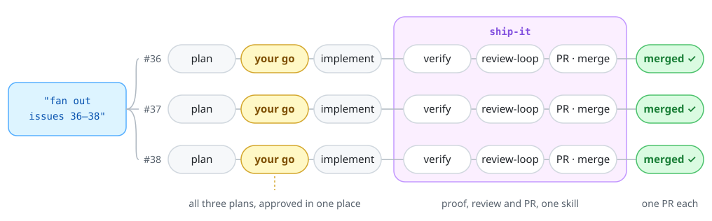

# Good Vibes Only ✌️

Twelve Claude Code skills that take your agents' work from "done, I think" to merged, deployed and checked live. You stop babysitting and start reviewing plans.

[](#install)
[](https://github.com/pingdotgg/t3code)
[](https://github.com/dinooo13/good-vibes-only/actions/workflows/ci.yml)
[](LICENSE)

<p align="center">
  <picture>
    <source media="(prefers-color-scheme: dark)" srcset="assets/project-digest-dark.png">
    
  </picture>
  <br>
  <sub>A Tuesday morning in my own repos, as project-digest shows it in T3 Code.</sub>
</p>

## Install

In Claude Code:

```
/plugin marketplace add dinooo13/good-vibes-only
/plugin install good-vibes-only@good-vibes-only
```

That's it. Claude picks a skill from what you say, or you call one by name, like `/good-vibes-only:ship-it`.

They work in any Claude Code session and shine in [T3 Code](https://github.com/pingdotgg/t3code), where they get threads, agents on other providers, PR watching, a preview browser, simulators and schedules.

## Why you'll like it

- **"Ship it" means shipped.** Proof, a fresh review, CI, review bots, rebases, the merge, the deploy and a look at it live. Not "PR opened, good luck".
- **A reviewer with fresh eyes, every round.** No shared history, so nothing gets waved through. It keeps going until it approves, or brings three providers at once when you say "council".
- **Five issues, one approval.** fan-out gives each issue its own thread and worktree. You approve all the plans in one place, and each comes back as its own merged PR.
- **Proof you can see.** The change working in the browser, the simulator or the real app, including the long text, the phone width and dark mode. Not a wall of green mocked tests.
- **Mornings start with a list.** Who's waiting on you, where every issue stands, and what to start next, like the page above.

## The lineup

Click a skill for what it does in detail.

| Skill | Say | You get |
| --- | --- | --- |
| **Land changes** | | |
| [ship-it](plugins/good-vibes-only/skills/ship-it) | "ship it", "merge when green" | Proof, a review loop, PR, babysitting, rebase, merge, deploy, a live check, cleanup |
| [review-loop](plugins/good-vibes-only/skills/review-loop) | "review loop", "council" | Fresh reviewers, round after round, until one approves |
| [verify](plugins/good-vibes-only/skills/verify) | "verify yourself" | Proof you can see: browser, simulator, the real app, the hard states |
| [build-verification-environment](plugins/good-vibes-only/skills/build-verification-environment) | "build a verification environment" | Build script, demo mode, scripted screenshots and benchmarks, so agents check their own work |
| [pr-comments](plugins/good-vibes-only/skills/pr-comments) | "draft a reply on the PR" | Short comments in your voice, shown as drafts before people see them |
| **Let agents run on their own** | | |
| [fan-out](plugins/good-vibes-only/skills/fan-out) | "fan out issues 36, 37 and 38" | One thread per issue: plan, your go, implement, verify, review, ship |
| [handoff](plugins/good-vibes-only/skills/handoff) | "write a handoff" | A brief that lets a new thread carry on without your history |
| [hill-climb](plugins/good-vibes-only/skills/hill-climb) | "iterate until the reviewer gives at least 9" | Critic rounds with a fixed rubric until the score hits the target |
| **Keep tabs** | | |
| [project-digest](plugins/good-vibes-only/skills/project-digest) | "anything I need to look at?" | Who's waiting on you, where every issue stands, what to start next |
| [tidy-repos](plugins/good-vibes-only/skills/tidy-repos) | "clean up branches" | Merged branches and clean worktrees gone, stale work listed |
| **Polish the product** | | |
| [product-readme](plugins/good-vibes-only/skills/product-readme) | "make the README sell it" | A README that sells, like this one |
| [web-quality](plugins/good-vibes-only/skills/web-quality) | "check the Core Web Vitals" | Lighthouse, SEO and GEO, and a visual pass, before and after |

## How they team up

The skills call each other, which is why they come as one plugin. ship-it proves changes with verify, reviews them with review-loop and answers bots with pr-comments. verify runs the scripts that build-verification-environment set up. fan-out writes its briefs with handoff and lands every issue with ship-it:

<p align="center">
  <picture>
    <source media="(prefers-color-scheme: dark)" srcset="assets/fan-out-dark.svg">
    
  </picture>
</p>

## FAQ

**Do I need T3 Code?**
No. Every skill runs in plain Claude Code. Without T3, verify drives the browser with `playwright-cli` and fan-out runs a worktree subagent per issue.

**Will it merge or post anything without asking?**
Only what you asked for. "Ship it" allows a merge; "PR" alone stops at the merge gate. Comments a person will read are shown to you as drafts first. project-digest is read only, tidy-repos never deletes unmerged work, and product-readme touches the repo description only after your OK.

**Which models does it use?**
The newest of each family, never hardcoded IDs: Opus at xhigh for reviews, and Fable to plan and Opus to build in fan-out. Name another model and it wins.

**How do I update?**
`claude plugin marketplace update good-vibes-only`, then `claude plugin update good-vibes-only@good-vibes-only`.

## Credits

Several skills borrow ideas from Theo's [tstack](https://github.com/t3dotgg/tstack): review-loop from `council` and `sol-loop`, ship-it from `babysit-pr` and `full-send`, and pr-comments from `leaving-pr-comments`.

Want to change a skill? See [CONTRIBUTING.md](CONTRIBUTING.md).

[MIT](LICENSE) © Fabian Meyer
