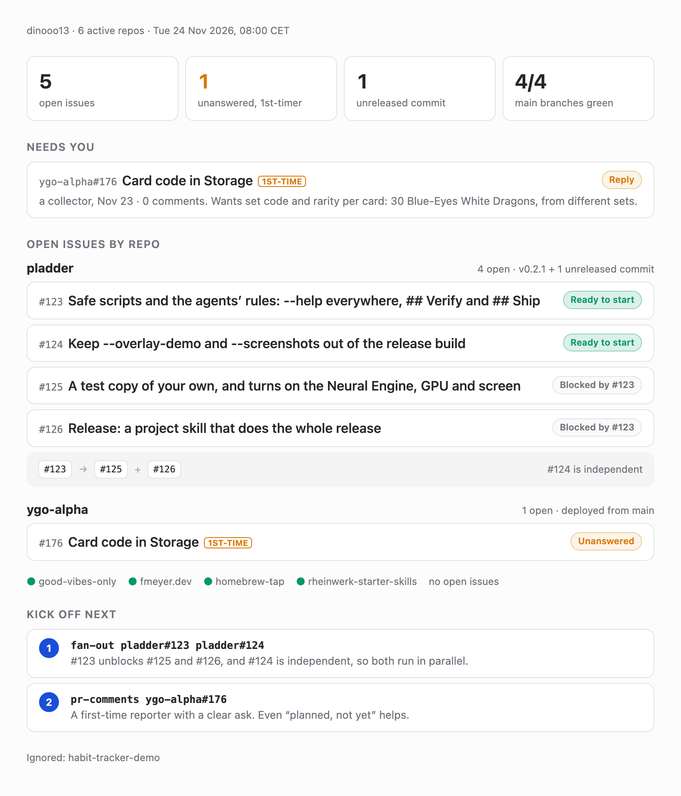

# project-digest

Who's waiting on you, where every open issue stands, what to start next.

**Say:** "anything I need to look at?"

<picture>
  <source media="(prefers-color-scheme: dark)" srcset="../../../../assets/project-digest-dark.png">
  
</picture>

The morning read. Everyone waiting on you, however long ago they asked (first-timers flagged), every open issue per repo with its status (ready to start, blocked by #N, PR in review, needs your yes) and how they depend on each other, PRs that are ready, failing or behind, red CI on any workflow on main, your PRs in other people's repos, and unreleased commits. It ends with up to three things to kick off next, as skill calls like `fan-out pladder#123`. In T3 Code it shows all of this as a page in the thread. Repos you list in `~/.config/good-vibes-only/digest.json` (`{ "ignore": ["dinooo13/habit-tracker-demo"] }`) are skipped, like a demo repo for a workshop. It's read only, so it's safe to run on a schedule.

---

Part of [Good Vibes Only](../../../../README.md). The instructions Claude follows are in [SKILL.md](SKILL.md).
